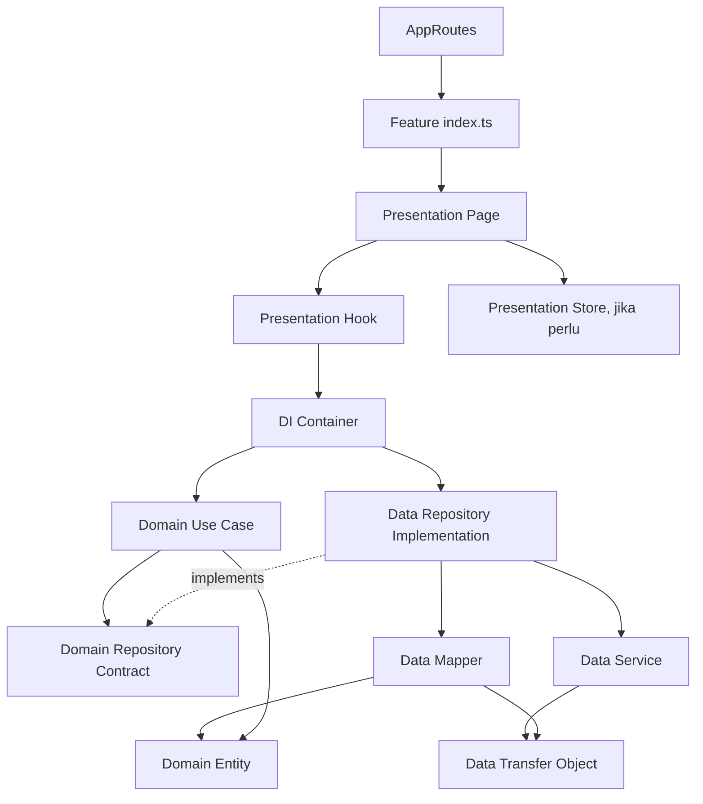

# HRIS Frontend

Starter template frontend HRIS berbasis React, TypeScript, dan Vite. Fitur baru mengikuti pola **Feature-Based Clean Architecture**: setiap fitur dipisahkan ke layer Domain, Data, Presentation, dan DI, dengan `index.ts` sebagai public API.

## Aturan Arsitektur

Gunakan tiga dokumen ini sebagai sumber aturan ketika menambah atau mengubah fitur:

1. [`folder-struktur.md`](./documentation/rules/domain-data-presentation/27%20Oktober%202026/folder-struktur.md) — struktur folder dan tanggung jawab setiap layer.
2. [`mermaid diagram.md`](./documentation/rules/domain-data-presentation/27%20Oktober%202026/mermaid%20diagram.md) — arah dependensi dan batas antarfitur.
3. [`rules.md`](./documentation/rules/domain-data-presentation/27%20Oktober%202026/rules.md) — detail implementasi Domain, Data, DI, Presentation, dan public API.

Jika contoh implementasi di tempat lain berbeda, ikuti aturan dan struktur pada dokumen-dokumen di atas untuk fitur baru.

## Teknologi

- React 19, TypeScript strict mode, dan Vite
- React Router untuk routing
- TanStack Query untuk state server
- Zustand untuk state UI lokal yang memang perlu dibagi
- Tailwind CSS untuk styling
- Jest dan Testing Library untuk pengujian

## Menjalankan Project

Pastikan Node.js dan npm tersedia, lalu jalankan dari root repository:

```powershell
npm install
npm run dev
```

Vite akan menampilkan URL development server, biasanya `http://localhost:5173`.

Perintah project:

```powershell
npm test -- --runInBand
npm run lint
npm run format:check
npm run build
```

`npm run build` menjalankan type-check TypeScript dan production build Vite. Script development dan build juga memperbarui manifest komponen `src/_reference_ui/manifest.ts`.

## Struktur Feature

Struktur feature mengikuti aturan project. Tidak semua folder wajib dibuat: tambahkan hanya bagian yang dibutuhkan oleh fitur.

```text
src/
├── features/
│   └── <feature>/
│       ├── index.ts                         # Public API fitur
│       ├── domain/
│       │   ├── entities/                    # Entity bisnis murni
│       │   ├── repositories/                # Kontrak repository
│       │   └── usecases/                    # Alur dan aturan bisnis
│       ├── data/
│       │   ├── dtos/                        # Bentuk data dari sumber data
│       │   ├── mappers/                     # DTO <-> entity
│       │   ├── services/                    # Akses API atau sumber data lain
│       │   └── repositories/                # Implementasi kontrak Domain
│       ├── di/                              # Merakit service, repository, use case
│       ├── presentation/
│       │   ├── components/                  # Komponen UI khusus fitur
│       │   ├── hooks/                       # Adapter UI, termasuk TanStack Query
│       │   ├── pages/                       # Halaman fitur
│       │   └── store/                       # State UI lokal jika dibutuhkan
│       └── __tests__/
│           ├── domain/
│           ├── data/
│           └── presentation/
├── components/                              # Komponen lintas fitur yang sudah ada
├── hooks/                                   # Hook lintas fitur yang sudah ada
├── stores/                                  # State global aplikasi yang sudah ada
├── routes/
│   └── AppRoutes.tsx                        # Registrasi route aplikasi
├── layout/
├── utils/
├── App.tsx
└── main.tsx
```

`shared/` dan `infrastructure/` pada blueprint dokumentasi adalah batas tanggung jawab arsitektur. Sebelum menambah folder global baru, periksa folder global yang sudah tersedia di project agar tidak membuat duplikasi.

### Contoh Implementasi: Fitur Karyawan

Fitur demo yang mengikuti struktur tersebut berada di `src/features/karyawan` dan dapat dibuka dari menu **Contoh Fitur Karyawan** (`/karyawan-demo`).

```text
src/features/karyawan/
├── index.ts
├── domain/
│   ├── entities/Karyawan.ts
│   ├── repositories/KaryawanRepository.interface.ts
│   └── usecases/GetKaryawanUseCase.ts
├── data/
│   ├── dtos/KaryawanDTO.ts
│   ├── mappers/KaryawanMapper.ts
│   ├── services/KaryawanApiService.ts
│   └── repositories/KaryawanRepositoryImpl.ts
├── di/KaryawanContainer.ts
├── presentation/
│   ├── components/KaryawanTable.tsx
│   ├── hooks/useKaryawanQuery.ts
│   ├── pages/KaryawanPage.tsx
│   └── store/karyawanStore.ts
└── __tests__/
    ├── data/
    ├── domain/
    └── presentation/
```

Service saat ini menggunakan data dummy karena endpoint backend belum tersedia. Ketika API sudah siap, ganti sumber data pada `data/services/KaryawanApiService.ts`; alur Domain dan Presentation seharusnya tetap memakai kontrak entity/repository yang sama.

## Tanggung Jawab Layer

### Domain

- Berisi entity, kontrak repository, dan use case.
- Gunakan TypeScript murni; jangan mengimpor React, TanStack Query, Zustand, Axios, atau detail implementasi Data.
- Kontrak repository didefinisikan di `domain/repositories/`, bukan digabungkan dengan entity.
- Use case menerima kontrak repository melalui constructor atau parameter. Letakkan aturan bisnis di sini, bukan di komponen UI.

### Data

- Service mengambil data dari API atau sumber data lain. Data dummy sementara juga diletakkan di service, bukan di halaman.
- DTO mencerminkan format sumber data; mapper mengubah DTO menjadi entity Domain yang bersih.
- Repository implementasi menghubungkan service dan mapper serta mengimplementasikan kontrak Domain.
- Data Layer boleh bergantung pada Domain, bukan sebaliknya.

### Dependency Injection (`di/`)

- Merakit service, repository implementasi, dan use case.
- Hook atau halaman tidak membuat repository maupun mengimpor implementasi Data secara langsung.

### Presentation

- Page dan komponen bertanggung jawab atas tampilan serta interaksi pengguna.
- Hook menghubungkan UI dengan use case; gunakan TanStack Query untuk state server dan Zustand hanya bila state UI perlu dibagi.
- Presentation tidak boleh mengakses service, DTO, mapper, atau repository implementasi secara langsung.

### Public API (`index.ts`)

- Ekspor halaman/entry point fitur yang perlu digunakan router atau consumer eksternal.
- File di luar fitur hanya mengimpor dari `@/features/<feature>`, bukan dari path internal seperti `@/features/<feature>/data/...`.
- Jangan mengekspor seluruh detail internal fitur tanpa kebutuhan yang jelas.

## Arah Dependensi dan Alur Data



Alur runtime data:

```text
Page → Hook → Use Case → Repository contract
                         ↑
DI → Repository implementation → Service → DTO
                              └→ Mapper → Entity → Presentation
```

Domain tetap independen dari React dan infrastruktur. DI adalah composition root yang mengetahui implementasi Domain dan Data, lalu memberikan use case siap pakai kepada Presentation.

## Batas Antarfitur

- Fitur lain hanya boleh mengakses public API melalui `src/features/<feature>/index.ts`.
- Jangan melakukan deep import ke `domain/`, `data/`, `di/`, atau `presentation/` milik fitur lain.
- Untuk UI, hook, type, atau utilitas yang benar-benar digunakan bersama, gunakan lokasi lintas fitur yang sesuai dengan struktur project atau ekstrak ke shared layer sesuai aturan.
- Router mengimpor halaman dari public API fitur, tidak dari path internal.

## Konvensi

- Gunakan nama berbahasa Inggris untuk identifier dan nama folder fitur; nama folder huruf kecil dengan dash untuk beberapa kata, misalnya `employee-benefits`.
- Gunakan PascalCase untuk nama file entity, DTO, mapper, service, repository, use case, page, dan component.
- Nama hook mengikuti pola React `use...`, misalnya `useKaryawanQuery.ts`.
- Beri tipe pada kontrak dan data; hindari `any`.
- Pertahankan error agar terlihat oleh pemanggil/UI. Jangan menyamarkan kegagalan dengan nilai sukses atau nilai default yang tidak valid.
- Hindari menambahkan store bila state hanya dipakai satu komponen dan dapat dikelola lokal.

## Pengujian

Tempatkan pengujian di dalam feature pada `__tests__/` sesuai layer yang diuji:

- `domain/`: aturan use case dan kontrak bisnis.
- `data/`: konversi mapper dan integrasi repository/service.
- `presentation/`: perilaku halaman/komponen seperti loading, error, empty state, dan interaksi pencarian.

Jalankan pengujian terfokus selama pengembangan, lalu validasi build dan lint sebelum menggabungkan perubahan:

```powershell
npm test -- --runInBand src/features/karyawan/__tests__
npx eslint src/features/karyawan
npm run build
```

## Catatan Repository

- `src/features/landing` dan `src/features/auth` adalah implementasi yang sudah ada dengan pola repository sebelumnya. Gunakan contoh `src/features/karyawan` dan dokumen aturan di atas sebagai acuan struktur untuk fitur baru.
- `src/_reference_ui/` adalah katalog UI referensi; halaman katalog dapat diakses melalui `/reference-ui`.
- Implementasi autentikasi dan route terlindungi tetap berada pada fitur serta konfigurasi route yang sudah tersedia.
